### Full-Stack Developer · Computer Science @ UP · Building Software

 

  

 

  

Hey! I'm Nyashadzashe, a full-stack developer and a Computer Science graduate. 

I enjoy working across the stack: building user-facing experiences, designing APIs, working with databases, and exploring how intelligent systems can make software more useful. I like learning by building, solving problems, and figuring out how all the pieces fit together.

 

*"Not all those who wander are lost." (J.R.R. Tolkien, The Fellowship of the Ring)*

 

  

 

  

  

 

  

<table align="center">
  <tr>
    <th width="25%" align="center">Reading</th>
    <th width="25%" align="center">Watching</th>
    <th width="25%" align="center">Art & Music</th>
    <th width="25%" align="center">Sport</th>
  </tr>
  <tr>
    <td align="left" valign="top">
      <ul>
        <li>Fourth Wing</li>
        <li>A Court of Thorns and Roses</li>
        <li>Divergent</li>
      </ul>
      
<i>Dragons, complicated worlds and epic quests</i>

    </td>
    <td align="left" valign="top">
      <ul>
        <li>The Legend of Vox Machina</li>
        <li>A Knight of the Seven Kingdoms</li>
        <li>Attack on Titan</li>
      </ul>
      
<i>Always open to a good story</i>

    </td>
    <td align="left" valign="top">
      <ul>
        <li>Watercolour painting</li>
        <li>Pen sketching</li>
        <li>Hans Zimmer</li>
        <li>Noah Kahan</li>
      </ul>
      
<i>Art is transformative</i>

    </td>
    <td align="left" valign="top">
      <ul>
        <li>Tennis</li>
        <li>Basketball</li>
        <li>Volleyball</li>
        <li>100m</li>
      </ul>
      
<i>Depending on the day</i>

    </td>
  </tr>
</table>

<b>Fun fact: the legend of "Mrs Chatter-box" (click to unseal)</b>

 

In Grade 3, my entire class (teacher included) made a song called *"Mrs Chatter-box"* about me. I would tell you how it went, but that might prove their point.

  

 

  

*"Every great story starts with a first step."*

  

 

  

 
 

*Thanks for stopping by. May your builds be stable, your bugs be few, and your commits legendary.*

